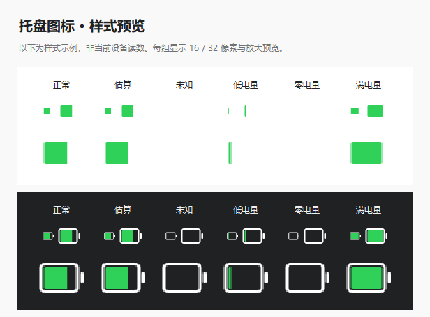

# Wireless Battery Monitor

Windows 外设电量监控工具，支持 Logitech GPW 一代、VGN S99 和 LEOBOG Alice 75。
使用 Python 标准库与 tkinter，无需第三方 Python 依赖。

## 功能

- 白色边框、绿色填充的 iOS 风格托盘电池，无数字；悬停查看各设备电量、状态与时间。
- 三设备面板、定时或手动刷新、低电量提醒、可选开机自启。
- 休眠或离线时保留上次成功读数，并标注历史状态与原时间。
- GPW 支持 LIGHTSPEED 接收器和 USB 有线连接；插线时优先读取有线接口。
- GPW、S99 与 Alice 75 设备设置界面，包含灯效、按键与宏等已实现功能。

## 运行

需要 Windows 10/11、Python 3.10+（含 tkinter）。下载并解压仓库后，在项目目录运行：

```powershell
python -B main.py
```

双击 `启动监控.vbs` 可隐藏控制台启动。启动器优先使用环境变量
`WIRELESS_BATTERY_PYTHON` 指定的 pythonw.exe，其次查找项目内 `.venv`、
原电脑的 `D:\PPPPP\pythonw.exe`，最后使用 PATH 中的 `pythonw.exe`。
如找不到 Python，可直接使用上面的命令行方式。

```powershell
python -B main.py --once   # 查询一次，输出 JSON
python -B main.py --scan   # 仅扫描 HID 描述信息，保存本地诊断报告
```

配置、电量历史、日志与备份保存在项目的 `runtime/` 内，首次启动时自动创建。
关闭窗口默认收起到托盘，完全退出请使用托盘菜单。默认关闭开机自启。

## 设备与限制

| 设备 | 电量通道 | 说明 |
|---|---|---|
| Logitech GPW 一代 | `046D:C539` 无线 / `046D:C088` 有线，HID++ | 当前机型通过电压推算百分比，属于估算；设备设置仍走已验证的无线接口 |
| VGN S99 | `320F:5088` 接收器，Report ID `04` / `0x1A` | 百分比直接来自设备协议；接收器回复不能单独证明键盘已唤醒 |
| LEOBOG Alice 75 | `3554:FA09`，Report ID `13` / `0x4A` | PID 为多个型号共享，仅适配此前确认的设备；配置写入尚待真机验收 |

GPW USB 有线电量已做真机读取；物理拔插切换主要有模拟测试，仍需更多实机验证。
充电、电池老化、温度和负载均会影响 GPW 的电压估算精度。
Alice 75 设置保留原先的接收器路径摘要校验，换电脑或换 USB 端口后可能拒绝写入。
不要直接移除校验来适配其他设备，应先验证型号与接口。
S99 和 Alice 75 宏覆盖不能完整备份未知旧宏，应用前应在原工具中导出。
设备设置只有在用户主动应用时才写入，日常电量查询不修改固件或设备配置。
“打开官方软件”按钮保留原电脑的安装路径，其他电脑需自行调整。

## 测试

下面的测试使用模拟协议，不向真机写入设置；部分用例会短暂创建本程序的 Tk 窗口。

```powershell
python -B -c "from config.settings import prepare_environment; prepare_environment(); import unittest; r=unittest.TextTestRunner(verbosity=2).run(unittest.defaultTestLoader.discover('tests')); raise SystemExit(not r.wasSuccessful())"
```

托盘图标的离线预览与图标资源释放检查：

```powershell
python -B -m diagnostics.tray_style_validation
```



## 源码包范围与许可证

本仓库包含程序、必要设备模型与图片、测试及部分诊断脚本。
不包含本机配置、电量历史、日志、设备清单、设置备份、原始照片、
无授权参考快照、厂商脚本、反汇编摘录或分析工具。

采用 GPL-2.0-or-later，详见 [LICENSE](LICENSE) 和
[THIRD_PARTY_NOTICES.md](THIRD_PARTY_NOTICES.md)。
